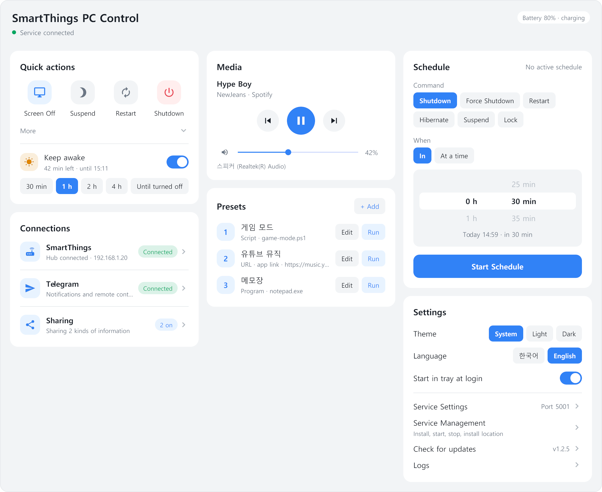
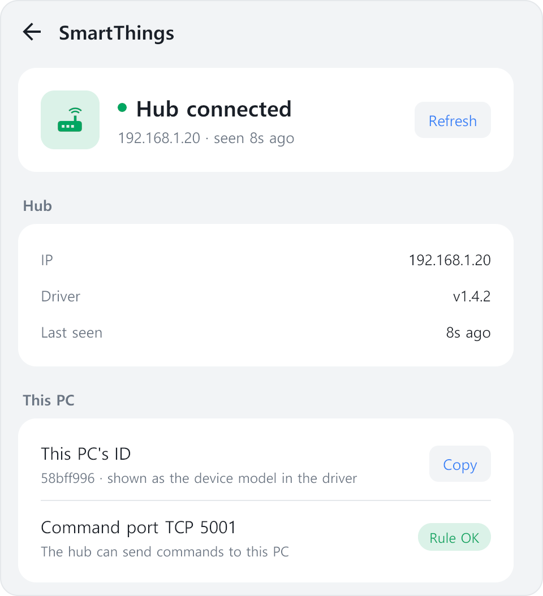
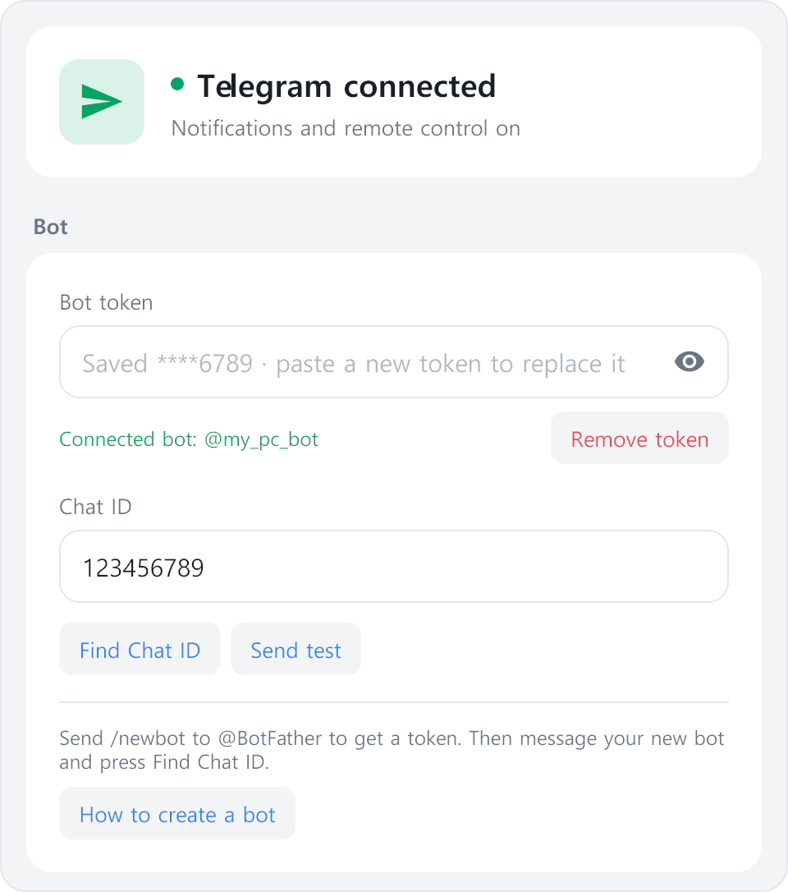
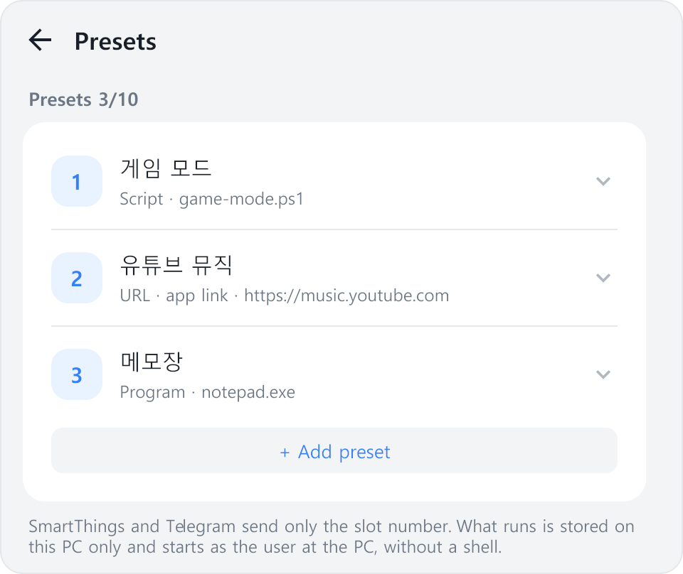
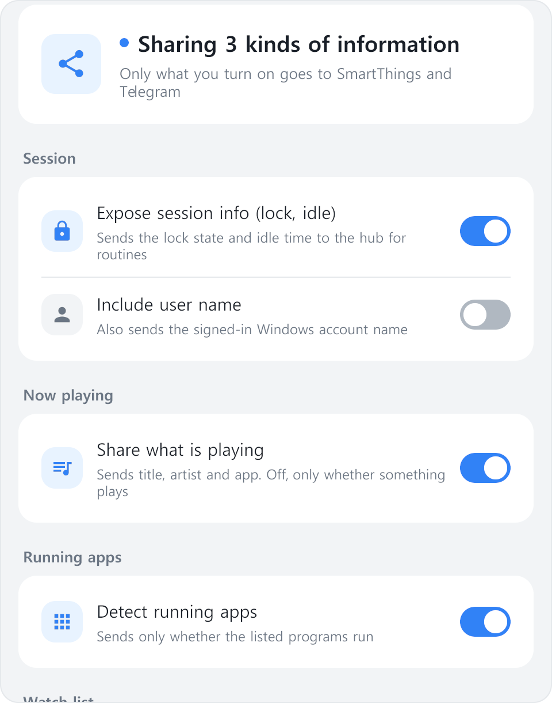
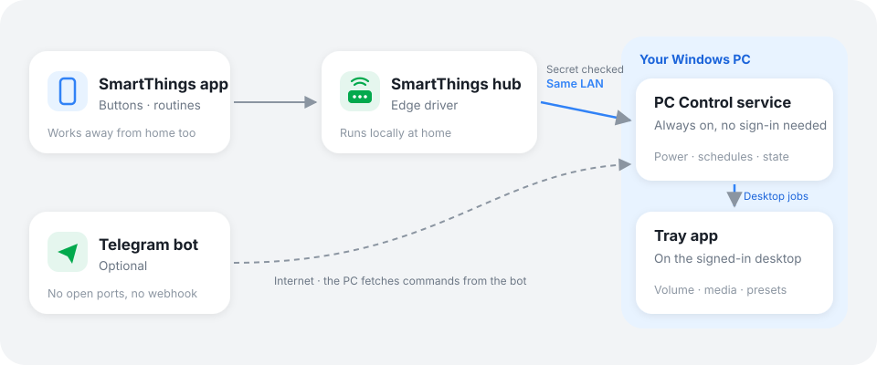

# SmartThings PC Control

**Turn your Windows PC on, off and down from SmartThings and Telegram.**

Shut the PC down from bed, schedule a shutdown while you're out, wake it every morning with a routine. 
One exe to install, and it is ready even before anyone signs in.

[**⬇ Download**](https://github.com/Protomothis/smartthings-pc-control/releases/latest) · [Install](#install) · [Wiki](https://github.com/Protomothis/smartthings-pc-control/wiki/Home-EN) · [한국어](README.md)

 

<picture>
  <source media="(prefers-color-scheme: dark)" srcset="docs/readme/en/home-wide-dark.png">
  
</picture>

 

## What it does

| Feature | What it does |
|---|---|
| ⚡ **Power** | Shutdown, restart, sleep, hibernate, lock, screen off/on. A remote shutdown waits out a grace period (5 min by default) you can cancel from anywhere. |
| 📡 **Real power state** | The SmartThings app shows on, asleep, hibernating, off, waking and shutdown pending as they are. |
| ⏰ **Wake and schedule** | Turning the switch on wakes the PC with Wake-on-LAN. Schedule a command up to 7 days ahead in the app (3 days from the SmartThings app); it survives a reboot, and you can cancel it any time. |
| ☀️ **Keep awake** | Hold off idle sleep for a while. Shutdown and sleep you ask for still happen. |
| 🔊 **Volume and media** | Volume, mute, play/pause, next and previous. Sharing what is playing is opt-in. |
| 💬 **PC notifications** | A SmartThings routine or Telegram `/say` puts a line of text on the PC's screen. |
| 🚀 **Presets** | Up to ten programs, URLs or scripts registered in the app, run remotely by slot number. |
| 👀 **Running-app detection** | Use whether a watched program (up to five) is running as a routine condition. Opt-in. |
| 🔋 **Laptop battery** | Level and charging state in SmartThings, Telegram and the app. |
| ✈️ **Telegram** | Get notifications from a bot and control the PC with `/status`, `/shutdown 30` and more. No open ports. |
| 🔒 **Signed auto-update** | Installs only signed releases and rolls back if an update fails. |

> [!NOTE]
> Volume, media, notifications and presets run in the tray app of the signed-in user. If the tray is not running, the service starts it again.

 

## A look around

Everything you use often is on one home screen; the rest is a tap away behind each card. Widen the window and the cards spread into two or three columns. The app follows the Windows dark mode.

<table>
  <tr>
    <td width="50%" valign="top"> <b>SmartThings</b> · hub connection and this PC&#39;s ID</td>
    <td width="50%" valign="top"> <b>Telegram</b> · bot and chat ID</td>
  </tr>
  <tr>
    <td valign="top"> <b>Presets</b> · programs, URLs and scripts to run remotely</td>
    <td valign="top"> <b>Sharing</b> · what goes to SmartThings</td>
  </tr>
</table>

 

## How it works

- The **service** runs whenever Windows is on, even before sign-in, and handles power commands, schedules and state.
- The **tray app** runs volume, media, notifications and presets on the signed-in user's desktop.
- The dedicated **Edge driver** talks to the PC from inside the hub, without going through the cloud.

 

## Install

### 1. Install on the PC

From [Releases](https://github.com/Protomothis/smartthings-pc-control/releases/latest), take whichever you like. Either way you get the service, autostart and firewall rules for TCP 5001 and UDP 1900.

| | Setup program (recommended) | Single exe |
|---|---|---|
| File | `SmartThingsPCControl-Setup-<version>.exe` | `smartthings-pc-control.exe` |
| Install | Run the wizard (UAC) | Put it in a permanent folder, run it → **Settings → Service Management → [Install]** |
| Location | `C:\Program Files\SmartThings PC Control\` | The folder you chose |
| Updates | Runs the next setup quietly | Replaces the exe |
| Uninstall | Windows Settings → Apps | **Service Management → [Uninstall service]** |

> [!TIP]
> Run the setup program over an exe install and it upgrades that folder in place. Pick another folder and it copies `config.json` over.

> [!WARNING]
> Releases are not code-signed yet, so Windows SmartScreen may warn you. Choose **More info → Run anyway**.

### 2. Set a secret

On the home screen, open **Settings → Service Settings**, set a **secret** and save. The hub sends it with every command.

### 3. Connect SmartThings

1. Open the channel invite, choose **[Enroll]** and pick your hub: <https://bestow-regional.api.smartthings.com/invite/Kr2zNWYgpp2A>
2. **[Install]** the **SmartThings PC Control** driver from the channel.
3. With the PC on, tap **[+] → Add device → Scan nearby** in the SmartThings app. This is the only way to add the device.
4. Enter the same **secret** in the new device's settings. Done.

> [!IMPORTANT]
> The hub and the PC must share a **subnet**, and the Windows network profile must be **Private**.

### Telegram (optional)

Create a bot with [@BotFather](https://t.me/BotFather), paste its token under **Connections → Telegram** on the home screen, then pick the chat with **[Find Chat ID]**. Use one bot per PC.

 

## FAQ

<b>Scan nearby doesn't find the PC</b>

Check the discovery responder, firewall rule and last search request on the app's **SmartThings** page (home → Connections). If the time never changes, the hub's search isn't reaching the PC: check that they share a subnet and the network profile is **Private**.

<b>Which device is which PC?</b>

The model `PC Control · <8 characters>` in the device info matches **This PC's ID** on the app's **SmartThings** page.

<b>Wake-on-LAN doesn't wake the PC</b>

Check the adapter chosen under **WoL adapter** on the **SmartThings** page and its WoL state. WoL must also be on in the BIOS and the network driver.

<b>Screen on doesn't work on my laptop</b>

It is a modern standby (S0) laptop: `powercfg /a` lists `Standby (S0 Low Power Idle)`. On these, Sleep and Screen off both enter Windows standby, which then wakes only on real keyboard or mouse input or the power button.

<b>Volume or notification commands say the tray app is not running</b>

If you quit the tray from its menu, it is not started again until you next sign in. Open the app from the Start menu. These commands also don't work while nobody is signed in.

<b>Where are the logs and crash records?</b>

- Service: `service.log` in the install folder (**Logs** at the bottom of the home screen)
- Tray: `%LOCALAPPDATA%\SmartThings PC Control\gui.log`
- If something quits unexpectedly, turn on **Settings → Service Settings → Advanced → Debug mode**; the next crash leaves a record in a `crash\` folder.

 

## Security

<b>How it is protected</b>

- The driver sends the secret in the `X-PC-Secret` header, not the URL. **With an empty secret anyone on the LAN can control the PC**, so set one.
- Put hub IPs in `smartthings.allowed_hubs` to accept commands from those hubs only.
- The app's local API binds to `127.0.0.1:5002`. The browser WebUI opens to the LAN only when you set a secret and enable remote access, and covers status, power commands, schedules and core settings.
- Editing and testing presets, the watch list and the running-program list are for the app on the PC only.
- The tray app gets desktop jobs only after the service has checked its process and session.
- `config.json`, which holds the secret, is readable by administrators only; the Telegram bot token is encrypted with DPAPI.
- Running-app detection reports only programs on your watch list and never stores, logs or sends other program names.
- Updates install only after the Ed25519 manifest signature and the file's SHA-256 check out.

 

## Docs and development

- [Wiki](https://github.com/Protomothis/smartthings-pc-control/wiki/Home-EN) (most pages are Korean)
- Changes: [CHANGELOG](CHANGELOG.md) · [driver CHANGELOG](edge/CHANGELOG.md)
- Development: [CONTRIBUTING.md](CONTRIBUTING.md) · driver [`edge/README.md`](edge/README.md)
- Built with Go and [Gio](https://gioui.org). Runs on Windows 10 and 11.

 

## Sponsor

This project is free, and every feature will stay free. If it helps you, a ⭐ **star** or [GitHub Sponsors](https://github.com/sponsors/Protomothis) keeps it going: sponsorship pays for real-device testing such as Android phones and SmartThings hubs. Bug reports and wiki fixes help just as much.

 

<a href="LICENSE">MIT License</a> · SmartThings is a trademark of Samsung Electronics. This is a personal project, not affiliated with Samsung.

