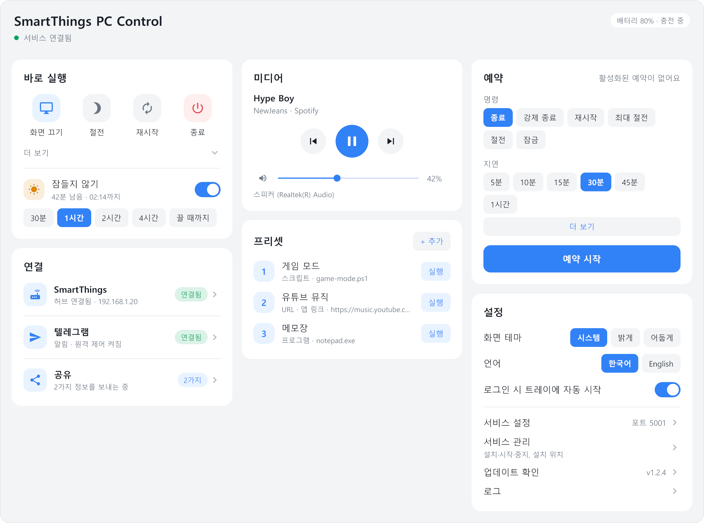
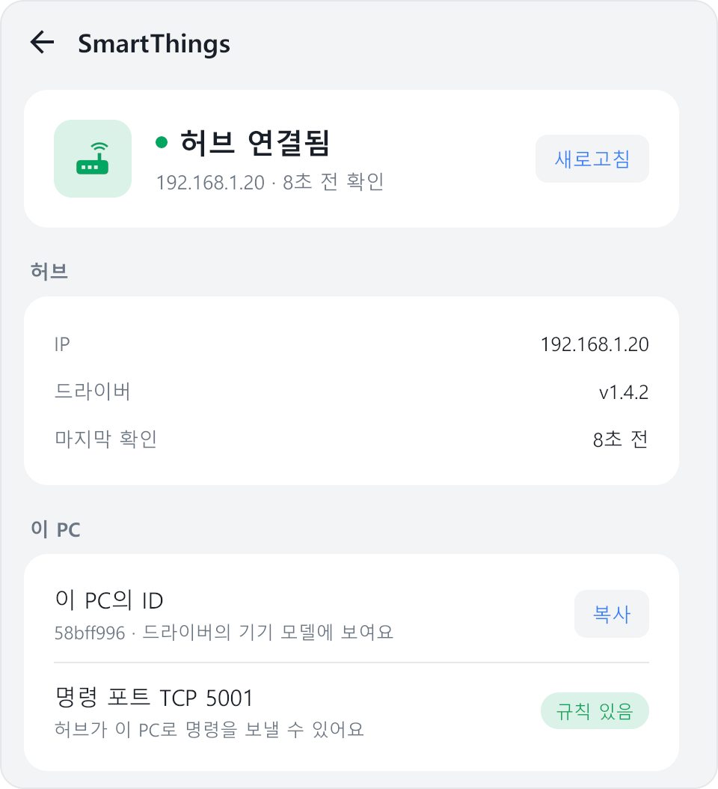
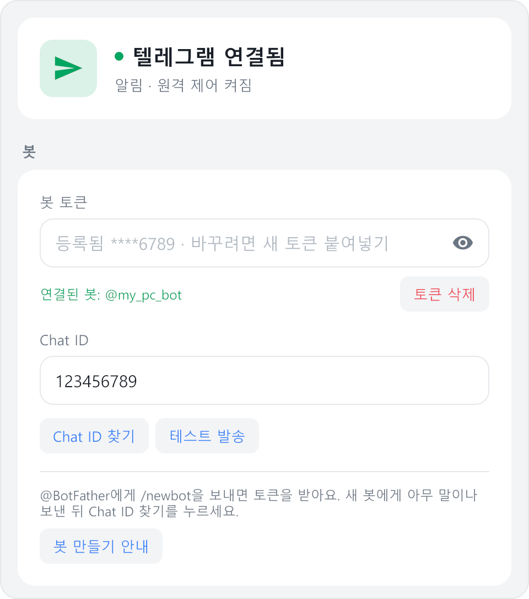
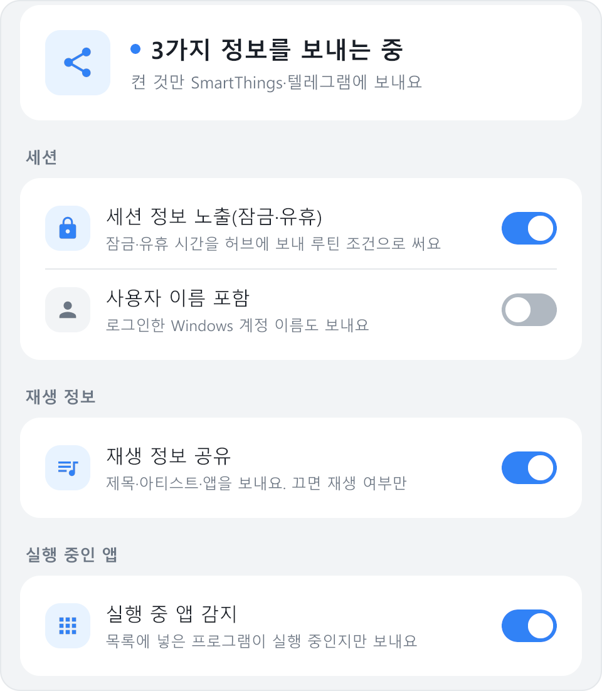
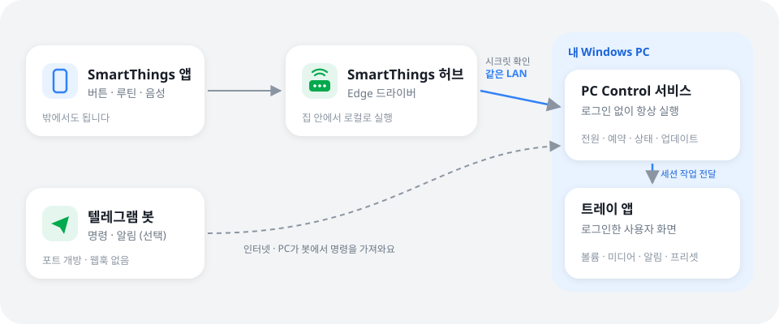

# SmartThings PC Control

**SmartThings와 텔레그램으로 Windows PC를 켜고, 끄고, 조절하세요.**

침대에서 PC 끄기, 외출 중에 원격 종료 예약, 루틴으로 아침마다 PC 깨우기까지. 
exe 하나로 설치하고, 로그인하지 않아도 항상 대기해요.

[**⬇ 내려받기**](https://github.com/Protomothis/smartthings-pc-control/releases/latest) · [설치 방법](#설치) · [위키](https://github.com/Protomothis/smartthings-pc-control/wiki) · [English](README.en.md)

 

<picture>
  <source media="(prefers-color-scheme: dark)" srcset="docs/readme/home-wide-dark.png">
  
</picture>

 

## 이런 걸 할 수 있어요

| 기능 | 설명 |
|---|---|
| ⚡ **전원** | 종료 · 재시작 · 절전 · 최대 절전 · 잠금 · 화면 끄기/켜기. 원격 종료는 유예(기본 5분) 동안 어디서든 취소할 수 있어요. |
| 📡 **진짜 전원 상태** | SmartThings 앱에 켜짐 · 절전 · 최대 절전 · 꺼짐 · 깨우는 중 · 종료 대기가 그대로 보여요. |
| ⏰ **깨우기와 예약** | 스위치를 켜면 Wake-on-LAN으로 PC를 깨워요. 앱에서는 7일 뒤까지(SmartThings 앱에서는 3일) 예약하고, PC를 재부팅해도 예약이 남아요. 언제든 취소할 수 있어요. |
| ☀️ **잠들지 않기** | 정한 시간 동안 자동 절전을 막아요. 직접 보낸 종료 · 절전은 그대로 실행돼요. |
| 🔊 **볼륨 · 미디어** | 볼륨 · 음소거, 재생 · 일시정지 · 이전/다음 곡. 재생 정보 공유는 켤 때만 보내요. |
| 💬 **PC 알림** | SmartThings 루틴이나 텔레그램 `/say`로 PC 화면에 문구를 띄워요. |
| 🚀 **프리셋** | 앱에 등록한 프로그램 · URL · 스크립트(최대 10개)를 원격에서 슬롯 번호로 실행해요. |
| 👀 **실행 중 앱 감지** | 감시 목록(최대 5개)의 프로그램이 켜져 있는지 루틴 조건으로 써요. 켤 때만 동작해요. |
| 🔋 **노트북 배터리** | 잔량과 충전 상태를 SmartThings · 텔레그램 · 앱에서 봐요. |
| ✈️ **텔레그램** | 봇으로 알림을 받고 `/status` `/shutdown 30` 같은 명령으로 제어해요. 포트 개방은 필요 없어요. |
| 🔒 **서명된 자동 업데이트** | 서명이 확인된 릴리스만 설치하고, 실패하면 이전 버전으로 되돌려요. |

> [!NOTE]
> 볼륨 · 미디어 · PC 알림 · 프리셋은 PC에 로그인한 사용자가 있을 때 트레이 앱이 실행해요. 트레이가 꺼져 있으면 서비스가 다시 띄워요.

 

## 화면 둘러보기

설정 앱은 홈 한 장에 자주 쓰는 걸 모으고, 나머지는 카드를 눌러 들어가요. 창을 넓히면 카드가 2열 · 3열로 펼쳐지고, Windows 다크 모드를 따라가요.

<table>
  <tr>
    <td width="50%" valign="top"> <b>SmartThings</b> · 허브 연결 상태와 이 PC의 ID</td>
    <td width="50%" valign="top"> <b>텔레그램</b> · 봇 연결과 Chat ID</td>
  </tr>
  <tr>
    <td valign="top"> <b>프리셋</b> · 원격으로 실행할 프로그램 · URL · 스크립트</td>
    <td valign="top"> <b>공유</b> · SmartThings로 보낼 정보 고르기</td>
  </tr>
</table>

 

## 어떻게 동작하나요

- **서비스**는 Windows가 켜져 있으면 로그인 전에도 항상 대기하면서 전원 명령 · 예약 · 상태를 맡아요.
- **트레이 앱**은 로그인한 사용자의 화면에서 볼륨 · 미디어 · 알림 · 프리셋을 실행해요.
- 전용 **Edge 드라이버**는 클라우드를 거치지 않고 허브 안에서 PC와 바로 이야기해요.

 

## 설치

### 1. PC에 설치하기

[Releases](https://github.com/Protomothis/smartthings-pc-control/releases/latest)에서 둘 중 편한 걸 받으세요. 어느 쪽이든 서비스 · 자동 시작 · 방화벽 규칙(TCP 5001, UDP 1900)이 만들어져요.

| | 설치 프로그램 (추천) | exe 하나 |
|---|---|---|
| 파일 | `SmartThingsPCControl-Setup-<버전>.exe` | `smartthings-pc-control.exe` |
| 설치 | 실행 → 마법사 따라가기(UAC 승인) | 고정된 폴더에 두고 실행 → **설정 → 서비스 관리 → [설치]** |
| 위치 | `C:\Program Files\SmartThings PC Control\` | 직접 고른 폴더 |
| 업데이트 | 새 설치 프로그램으로 조용히 | exe를 직접 바꿔 끼움 |
| 제거 | Windows 설정 → 앱 | **서비스 관리 → [서비스 제거]** |

> [!TIP]
> exe로 쓰던 PC에서 설치 프로그램을 실행하면 그 폴더에 그대로 덮어써요. 다른 폴더를 고르면 `config.json`을 옮겨 와요.

> [!WARNING]
> 아직 코드 서명이 없어서 Windows SmartScreen이 경고할 수 있어요. **추가 정보 → 실행**을 누르면 설치돼요.

### 2. 시크릿 정하기

앱 홈의 **설정 → 서비스 설정**에서 **시크릿**을 정하고 [저장]하세요. 허브가 명령을 보낼 때 쓰는 비밀번호예요.

### 3. SmartThings에 연결하기

1. 채널 초대 링크를 열고 **[Enroll]** → 허브를 고르세요: <https://bestow-regional.api.smartthings.com/invite/Kr2zNWYgpp2A>
2. 채널의 **SmartThings PC Control** 드라이버를 **[Install]** 하세요.
3. PC가 켜진 상태에서 SmartThings 앱 **[+] → 기기 추가 → 주변 기기 검색**을 누르세요. 장치는 이 검색으로만 추가돼요.
4. 새로 생긴 장치의 설정에 같은 **시크릿**을 넣으면 끝이에요.

> [!IMPORTANT]
> 허브와 PC는 **같은 서브넷**에 있어야 하고, Windows 네트워크 프로필은 **개인**이어야 해요.

### 텔레그램 연결 (선택)

[@BotFather](https://t.me/BotFather)에서 봇을 만들고, 앱 홈의 **연결 → 텔레그램**에 토큰을 넣은 뒤 **[Chat ID 찾기]** 로 채팅을 고르세요. 봇 하나에 PC 하나를 쓰세요. 명령 목록은 위키 [텔레그램](https://github.com/Protomothis/smartthings-pc-control/wiki/텔레그램)에 있어요.

 

## 자주 묻는 질문

<b>주변 기기 검색에 PC가 안 나와요</b>

앱 홈의 **연결 → SmartThings** 화면에서 검색 응답기 · 방화벽 규칙 · 마지막 검색 요청 시각을 보세요. 시각이 바뀌지 않으면 허브의 검색 요청이 PC까지 오지 않는 거예요. 같은 서브넷인지, 네트워크 프로필이 **개인**인지 확인하세요.

<b>어느 장치가 어느 PC인지 모르겠어요</b>

SmartThings 장치 정보의 모델 `PC Control · <8자리>`가 앱 **SmartThings** 화면의 **이 PC의 ID**와 같아요.

<b>Wake-on-LAN으로 안 깨어나요</b>

**SmartThings** 화면의 **WoL 어댑터**에서 고른 랜카드와 그 WoL 상태를 확인하세요. BIOS와 랜카드 드라이버에서도 WoL이 켜져 있어야 해요.

<b>노트북에서 화면 켜기가 안 들어요</b>

모던 스탠바이(S0) 노트북이에요. `powercfg /a`에 `S0 저전력 유휴`가 보이면 해당돼요. 이런 PC는 절전과 화면 끄기가 같은 Windows 절전이 되고, 그 뒤에는 실제 키보드 · 마우스나 전원 버튼으로만 깨어나요.

<b>볼륨 · 알림 명령이 "트레이 앱이 꺼져 있어" 실패해요</b>

트레이 메뉴의 **[종료]** 로 직접 끄면 다음 로그인까지 다시 띄우지 않아요. 시작 메뉴에서 앱을 다시 열면 돼요. 아무도 로그인하지 않은 PC에서도 이 명령들은 동작하지 않아요.

<b>로그와 크래시 기록은 어디 있나요</b>

- 서비스: 설치 폴더의 `service.log` (앱 홈 맨 아래 **로그**)
- 트레이: `%LOCALAPPDATA%\SmartThings PC Control\gui.log`
- 갑자기 꺼질 때는 **설정 → 서비스 설정 → 고급 → 디버그 모드**를 켜 두세요. 다음 비정상 종료 때 `crash\` 폴더에 기록이 남아요.

<b>config.json을 직접 고치고 싶어요</b>

설치 폴더는 관리자 전용이라 관리자 권한 편집기가 필요해요. 키 목록은 위키 [설정 파일 레퍼런스](https://github.com/Protomothis/smartthings-pc-control/wiki/설정-파일-레퍼런스)에 있어요.

더 많은 사례는 위키 [문제 해결과 FAQ](https://github.com/Protomothis/smartthings-pc-control/wiki/문제-해결과-FAQ)에 있어요.

 

## 보안

<b>어떻게 지키나요</b>

- 드라이버는 시크릿을 URL이 아닌 `X-PC-Secret` 헤더로 보내요. **시크릿이 비어 있으면 LAN의 누구나 PC를 제어할 수 있으니** 꼭 정하세요.
- `smartthings.allowed_hubs`에 허브 IP를 넣으면 그 허브만 명령을 보낼 수 있어요.
- 앱의 로컬 API는 `127.0.0.1:5002`에만 열려요. 브라우저 WebUI는 시크릿을 정하고 원격 접속을 켰을 때만 LAN에 열리고, 상태 · 전원 명령 · 예약 · 핵심 설정만 다뤄요.
- 프리셋 편집 · 테스트, 감시 목록, 실행 중 프로그램 목록은 이 PC의 앱에서만 다룰 수 있어요.
- 트레이 앱은 서비스가 프로세스와 세션을 확인한 경우에만 사용자 화면의 작업을 받아요.
- 시크릿이 든 `config.json`은 관리자만 읽고, 텔레그램 봇 토큰은 DPAPI로 암호화해요.
- 앱 감지는 감시 목록에 넣은 프로그램만 보고하고, 다른 프로그램 이름은 저장 · 로그 · 전송하지 않아요.
- 자동 업데이트는 Ed25519 매니페스트 서명과 파일 SHA-256을 확인한 뒤에만 설치해요.

 

## 문서와 개발

- [위키](https://github.com/Protomothis/smartthings-pc-control/wiki): [설치와 첫 설정](https://github.com/Protomothis/smartthings-pc-control/wiki/설치와-첫-설정) · [SmartThings Edge 드라이버](https://github.com/Protomothis/smartthings-pc-control/wiki/SmartThings-Edge-드라이버) · [CLI와 API 레퍼런스](https://github.com/Protomothis/smartthings-pc-control/wiki/CLI와-API-레퍼런스)
- 변경 이력: [CHANGELOG](CHANGELOG.md) · [드라이버 CHANGELOG](edge/CHANGELOG.md)
- 개발: [CONTRIBUTING.md](CONTRIBUTING.md) · 드라이버 [`edge/README.md`](edge/README.md) · 설계 [`docs/design/`](docs/design/)
- Go와 [Gio](https://gioui.org)로 만들었어요. 지원 환경은 Windows 10 · 11이에요.

 

## 응원하기

이 프로젝트는 무료이고, 모든 기능은 앞으로도 무료예요. 도움이 됐다면 ⭐ **Star**나 [GitHub Sponsors](https://github.com/sponsors/Protomothis)로 응원해 주세요. 후원은 테스트용 안드로이드 기기와 SmartThings 허브처럼 실제 환경 검증에 써요. 버그 제보와 위키 개선도 큰 힘이 돼요.

 

<a href="LICENSE">MIT 라이선스</a> · SmartThings는 Samsung Electronics의 상표이며, 이 프로젝트는 Samsung과 관계없는 개인 프로젝트예요.

